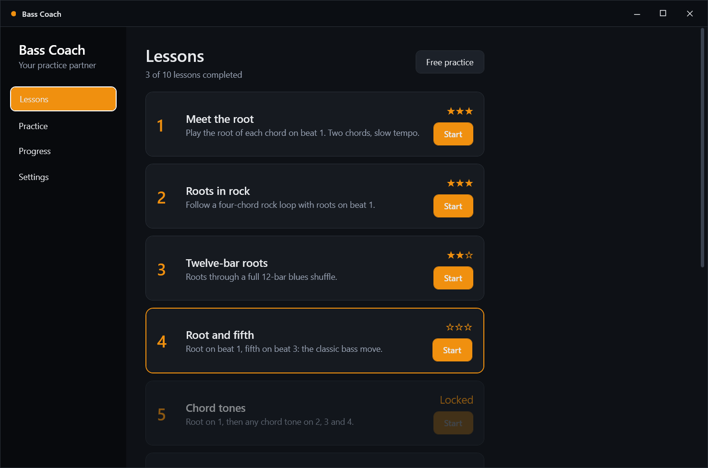
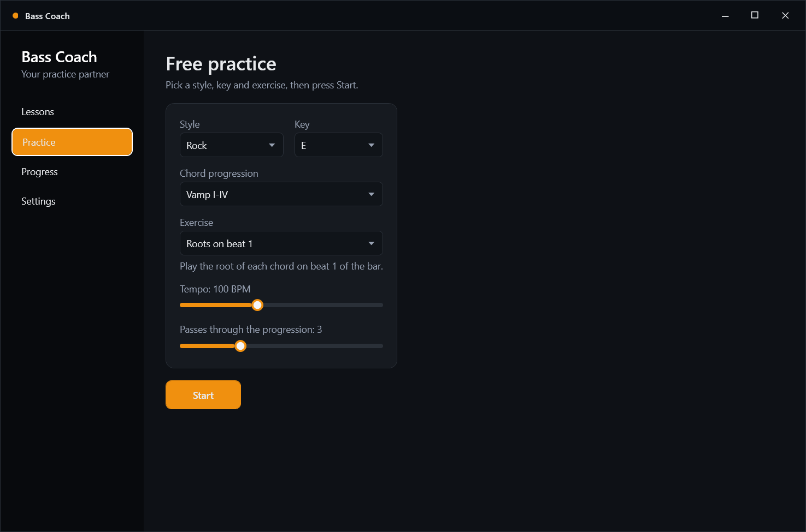
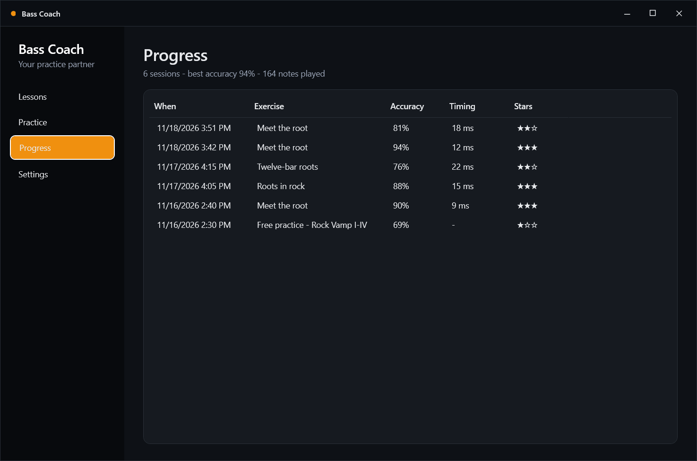
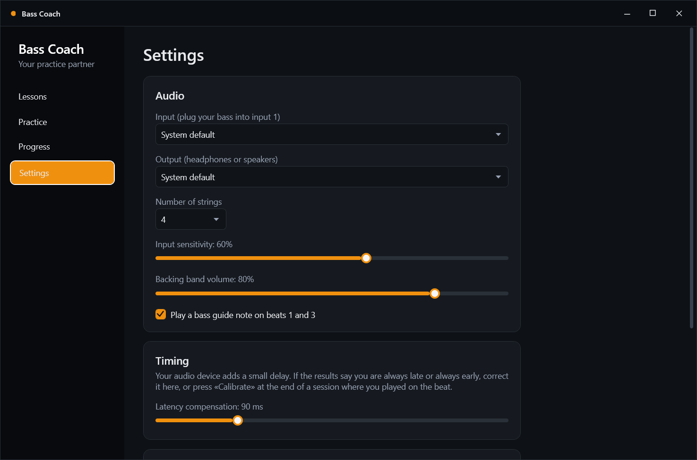

# Bass Coach

A practice partner for bass players. It plays a backing band (drums and chords) over a chord progression, **listens to your bass**, tells you in real time whether you played the right note on the beat, and gives coaching tips after every run. Ten built-in lessons unlock one after another.

It is a practice tool, not a replacement for a human teacher: it can judge notes and timing, but it cannot judge your technique, tone or feel.

## Screenshots

| Lessons | Free practice |
|---|---|
|  |  |

| Progress | Settings |
|---|---|
|  |  |

## For players

**Requirements:** Windows 10/11 (64-bit). A bass plugged into an audio interface (input 1) works best; a microphone in front of an amp also works, with less accuracy. Use headphones so the backing band does not leak into the input.

**Install:** run `Install-BassCoach-x.y.z-x64.msi` and click Next, Install, Finish. It installs for the current user under `%LOCALAPPDATA%\Programs\Bass Coach` and needs no administrator rights. A Start Menu shortcut is always created; the desktop shortcut is optional. You can also launch the app from the last page of the installer.

**First run**
1. Open **Settings**, choose your input and output, pick 4 or 5 strings, and press **Test my input**. Play a note: you should see its name and the level meter move. Adjust *sensitivity* until only your playing registers. Save.
2. Open **Lessons** and start lesson 1.
3. After a run, read the feedback. If the result says you are *always* late or early, press **Calibrate timing** (only if you really played on the beat) or change *Latency compensation* in Settings.

**How it scores:** each exercise defines target notes (for example "root on beat 1"). A target is hit when you play an allowed note within half a beat (max 250 ms). Timing is rated *perfect* (within 50 ms), *good* (110 ms), then early/late. Stars: 3 = 90 % accuracy and under 60 ms average error, 2 = 80 % and under 100 ms (passes the lesson), 1 = 60 %. *Free groove* scores every note by whether it belongs to the chord or its scale.

**Styles:** Rock, Pop, Blues, Jazz, Bachata, Merengue, Salsa. The Latin grooves are simplified practice patterns, not authentic transcriptions.

**Limits you should know**
- One note at a time (no chords or double stops). Mute the strings you are not playing: two ringing strings can confuse the attack detector.
- Notes arrive about 170 ms after you play them (the detector needs a moment to hear the pitch). Scoring uses the real attack time, so this only delays the on-screen feedback.
- The 5-string low B (31 Hz) is identified correctly but is not tuner-grade accurate. The needle is a guide, not a tuner.
- Timing depends on your audio device. Latency compensation is a single number; a good interface with a small buffer gives the most reliable results.

Your data lives in `%APPDATA%\BassCoach` (settings and progress). Errors are logged to `%LOCALAPPDATA%\BassCoach\logs`.

## For developers

```
src/BassCoach.Core          music theory, pitch detection (YIN), note tracking, backing-band synth,
                            evaluation, lessons, storage - no UI, no OS dependencies
src/BassCoach.Presentation  view models (MVVM) - no WPF dependency, fully testable
src/BassCoach.Desktop       WPF views (XAML), NAudio/WASAPI bridge, fretboard control
tests/BassCoach.SelfTest    dependency-free test runner (31 tests, uses synthetic bass audio)
installer/BassCoach.wxs     WiX MSI installer (per-user, x64, Start Menu + optional desktop shortcut)
installer/License.rtf       EULA shown by the installer
installer/BassCoach.iss     legacy Inno Setup script, kept for reference only
```

Run the tests (any OS with the .NET 8 SDK): `dotnet run --project tests/BassCoach.SelfTest -c Release`

Build the installer on Windows: double-click `build-installer.bat` (needs the .NET 8 SDK and the WiX Toolset v7 CLI), or push to GitHub: the workflow in `.github/workflows/build.yml` runs the tests, publishes a self-contained build, builds and validates the MSI, and produces `dist\Install-BassCoach-x.y.z-x64.msi`. Tag a commit `v1.0.0` to attach it to a release.

WiX is required as a .NET global tool:

```
dotnet tool install --global wix --version 7.0.1
wix eula accept wix7
wix extension add --global WixToolset.UI.wixext/7.0.1
wix extension add --global WixToolset.Util.wixext/7.0.1
```

The installer requires Windows 10/11. Note that Windows Installer reports `VersionNT = 603` and `WindowsBuild = 9600` on every Windows 10/11 machine (Microsoft KB3202260), so the MSI checks `CurrentBuildNumber` from the registry instead of `VersionNT >= 1000`. The MSI is marked x64, so Windows Installer refuses it on platforms that cannot run x64 code (such as Windows 10 on ARM64); Windows 11 on ARM64 runs it through x64 emulation.

Design notes: the only code that touches hardware is `src/BassCoach.Desktop/Audio`. Everything else talks to `IAudioService`, so the whole practice flow is tested with a fake audio device that plays a simulated bassist.

### Status (read before shipping)
- **Verified by the automated tests:** theory, chord/scale logic, pitch detection on synthetic bass notes from 31 to 392 Hz at 44.1 and 48 kHz, note and onset tracking, backing-band timing, evaluation and scoring, lessons and unlocking, settings and progress storage, and every view-model flow (start, play, finish, save, unlock, errors, navigation).
- **Built and tested on Windows:** `dotnet build BassCoach.sln -c Release` succeeds with no warnings or errors, all 31 self-tests pass, and the self-contained win-x64 publish builds. The WPF layer compiles; XAML and bindings are only checked by the compiler, so a visual pass on real hardware is still worthwhile.
- **Installer verified:** the WiX MSI builds, `wix msi validate` reports no errors or warnings, and a silent install/uninstall was tested on Windows 10 22H2 (251 files, Start Menu and desktop shortcuts, Add/Remove Programs entry, clean removal). The installer requires Windows 10/11 and x64; the OS check uses the registry because MSI reports `VersionNT = 603` on Windows 10/11.
- **Needs a real bass:** real-world latency and calibration, microphone input, onset detection with real plucked/slapped notes and ringing strings, and the feel of the lesson difficulty.
- **Not included:** code signing (Windows SmartScreen will warn on first run), automatic updates, macOS/Linux support.
